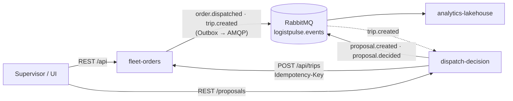
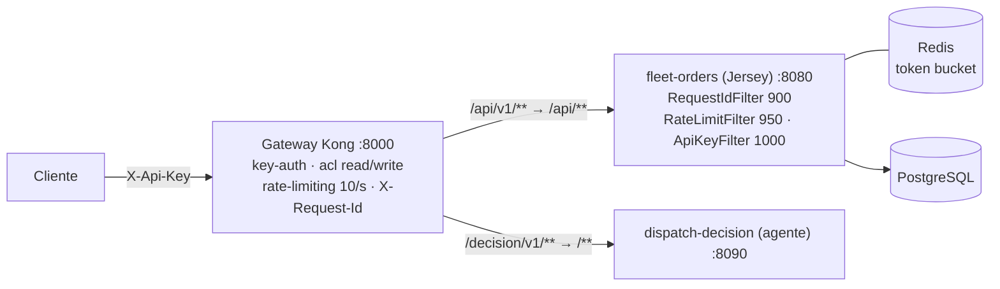

# Microservicios y diseño de APIs dirigido por contrato (API-first) en LOGISTPULSE

Este documento responde a una pregunta: **¿cómo se descompone LOGISTPULSE en servicios, y cómo se gobiernan sus APIs para que los equipos puedan cambiar sin romperse entre sí?** Sigue el mismo método de Smart Inventory (API Product Canvas → contrato OpenAPI/AsyncAPI → catálogo → validación en CI) y lo aplica a logística.

## 1. Descomposición por contextos acotados (qué es y qué no es un microservicio hoy)

| Contexto acotado | Servicio | Implementación actual | Datos que posee | ¿Ya es un servicio independiente? |
|---|---|---|---|---|
| Pedidos y Flota | `fleet-orders` | `base/lab` (Java, Jersey) | pedidos, robots, viajes, outbox | **No**: es un monolito modular (un proceso, una BD). |
| Decisión de despacho | `dispatch-decision` | `base/agent` (Python) | propuestas, auditoría | **Sí**: proceso, lenguaje y despliegue propios. |
| Analítica y calidad de datos | `analytics-lakehouse` | `base/lakehouse` | esquemas `master`, `agent`, Gold | **Sí**, como plataforma de datos; solo consume eventos. |

**Lectura honesta.** No dividimos `fleet-orders` en tres microservicios (pedidos / flota / viajes) porque el invariante «un viaje cambia pedidos y batería de un robot **en una sola transacción, todo o nada**» exige una frontera transaccional común. Partirlo obligaría a una saga con compensaciones para algo que hoy resuelve una transacción local. Es la decisión del ADR-001.

## 2. ADR-001 · Monolito modular para Pedidos y Flota; servicios separados donde hay razón

- **Contexto:** un solo equipo, una sola BD, un invariante transaccional fuerte (`/api/trips`), carga de ~decenas de pedidos/día en el laboratorio.
- **Decisión:** mantener `fleet-orders` modular (paquetes `domain`, `service`, `api`, `messaging`) y **exponer sus fronteras como contratos**; separar solo lo que ya tiene ciclo de vida, lenguaje o autonomía distintos (el agente, el lakehouse).
- **Consecuencias:** (+) transacción simple, menos latencia y menos operación; (−) un despliegue único para pedidos y flota; (−) si un día se separa Flota, hará falta una saga.
- **Cuándo revertir (disparadores medibles):** equipos distintos que se bloquean entre sí al desplegar; necesidad de escalar flota y pedidos de forma independiente; tasa de cambios que rompe el despliegue conjunto.
- **Lo que protege la decisión aunque cambie:** como las fronteras ya son contratos, separar después es un cambio de despliegue, no de interfaz.

## 3. Contratos (fuente de la verdad): `contracts/`

| Archivo | Qué gobierna |
|---|---|
| `catalog.yaml` | Índice: servicios, dueño, ciclo de vida, dónde está cada contrato, eventos, reglas de versionado. **Catálogo ≠ contrato.** |
| `openapi/fleet-orders.v1.yaml` | REST de Pedidos y Flota, incluido `POST /api/trips` (idempotente, todo o nada). |
| `openapi/dispatch-decision.v1.yaml` | REST del agente: `/plan`, `/proposals`, `approve`/`reject` con `X-Approver`. |
| `asyncapi/logistpulse-events.v1.yaml` | Eventos `order.dispatched`, `trip.created`, `proposal.created`, `proposal.decided`. |
| `schemas/*.json` | Envelope común y payload de cada evento (JSON Schema). |
| `examples/*.json` | Un mensaje válido por evento; el CI los valida contra su esquema. |
| `baseline/` | Copia de la versión publicada contra la que se mide la compatibilidad. |
| `tools/validate_contracts.py` | Validador: catálogo ↔ archivos, `$ref`, ejemplos, **cambios incompatibles**. |

**Envelope común** (igual que Smart Inventory): `eventId, eventType, schemaVersion, occurredAt, correlationId, producer, payload`. `eventId` permite que el consumidor deduplique, porque la entrega es **al-menos-una-vez**.

### Reglas de versionado
- **Compatible → MINOR en el mismo `/v1`:** campo opcional nuevo, endpoint nuevo.
- **Incompatible → `/v2` y `schemaVersion: 2`, y `v1` convive** hasta que migre el último consumidor. Se considera incompatible: quitar un campo, cambiar un tipo, quitar valores de un enum, volver requerido un campo, añadir un parámetro requerido, quitar una operación o una respuesta.
- **Evolución de eventos:** los consumidores ignoran campos que no conocen (tolerant reader).

## 4. Flujo de trabajo API-first (lo que se evalúa)
1. **Canvas** del servicio (`docs/API_PRODUCT_CANVAS.md`): propuesta de valor, agregados, comandos, eventos, calidad.
2. **Contrato** primero (OpenAPI/AsyncAPI + JSON Schema) y revisión por pares.
3. **Validación en CI** (`ci-contratos.yml`): sintaxis, `$ref`, ejemplos, compatibilidad contra `baseline/`, y el **agente real contra su OpenAPI**.
4. **Implementación** que cumpla el contrato; las pruebas de contrato detectan la deriva.
5. **Publicar** en el catálogo y versionar.

## 5. Estado real: lo que cumple el contrato y lo que NO (deriva conocida)

| Elemento | Estado |
|---|---|
| Agente (`/plan`, `/proposals`, approve/reject) | **Verificado**: la prueba levanta el servidor real y valida respuestas 201/401/200/409/404 contra el OpenAPI. |
| Rutas `/api/orders`, `/api/robots`, `/api/trips` | Existen en el código Java (comprobación por texto). **Java no compilado aquí**; los esquemas de respuesta del lab no se han contrastado con un lab vivo. |
| **Eventos del lab** | **Deriva real.** El lab publica el id del pedido en la cola `orders.dispatched` (exchange por defecto), **sin envelope** y sin `trip.created`. El contrato manda: `OutboxPublisher` debe emitir el envelope al exchange `logistpulse.events` (topic). Es una tarea del Deber de Desarrollo de SW. |
| Eventos `proposal.*` del agente | **No implementados**: solo contrato. Tarea del Deber de Diseño de Sistemas (Observer → publicador). |
| Consumidor en el lakehouse | **No implementado**: solo contrato. |
| `X-Api-Key`, rate limit, `X-Request-Id`, gateway | **Implementado, sin ejecutar aquí** (ver §8): filtros Jersey en el lab + gateway Kong + contratos 401/403/429. Verificado: la lógica Java del límite y de las claves contra stubs, el script Lua en un Redis 7 real, y la coherencia gateway↔lab↔contrato. **No verificado:** compilación Maven, arranque de Kong y del stack. |

## 6. Cómo se conecta con la decisión logística
Las métricas del negocio (despachos fallidos, SLA, costo y horas-persona) dependen de que los servicios se pongan de acuerdo sin ambigüedad: un `409` bien definido evita despachos parciales; una `Idempotency-Key` evita despachar dos veces el mismo pedido ante un reintento; un evento versionado permite que analítica mida SLA sin acceder a la BD operativa. **El contrato es el mecanismo que convierte una decisión en un efecto confiable.**

## 7. Preguntas de exposición (microservicios y APIs)
1. ¿Por qué `fleet-orders` sigue siendo un monolito modular y qué evidencia haría cambiar el ADR-001?
2. Si Flota se separa de Pedidos, ¿cómo se garantiza «todo o nada» sin transacción compartida (saga, compensación)?
3. Un cliente de `proposal.decided` rompe al agregar un campo requerido: ¿qué regla de versionado se violó y cómo se detecta antes de producción?
4. ¿Qué pierde y qué gana el proceso de decisión al pasar de llamadas síncronas (`POST /api/trips`) a eventos?
5. ¿Qué pasa con las métricas de SLA si un evento se entrega dos veces? ¿Dónde se deduplica?
6. Compara el contrato de LOGISTPULSE con el API Product Canvas de Inventario: ¿qué comparten y qué es distinto (FEFO vs. rutas)?

## 8. Capa de API: gateway, clave, límite de tasa y correlación

**Qué es qué.** *Jersey* es la implementación de JAX-RS: sirve los endpoints dentro de la aplicación Java; **no** es un gestor de APIs. El **API manager/gateway** es otro componente (aquí **Kong**, `base/gateway/kong.yml`) que vive *delante* de los servicios y aplica políticas comunes sin tocar su código.

| Política | Gateway (Kong) | Servicio fleet-orders (Jersey) | Por qué en los dos |
|---|---|---|---|
| Identidad | `key-auth` (`X-Api-Key`, nunca en la URL) | `ApiKeyFilter`: SHA-256 + comparación en tiempo constante | Si alguien llama a `:8080` saltándose el gateway, igual no entra |
| Permisos | `acl`: rutas separadas para GET/HEAD/OPTIONS (`read`) y POST/PUT/PATCH/DELETE (`write`) | scope `read`/`write` según el método | 401 = no sé quién eres; **403 = sé quién eres y no puedes** |
| Límite de tasa | `rate-limiting`: 10/s por consumidor (ventana fija de 1 s) | token bucket en Redis: **ráfaga 20, recarga 10/s** (script Lua atómico) | El gateway corta lo grueso; el servicio protege aunque el gateway falle y frena a quien prueba claves (corre *antes* de validar la clave) |
| Correlación | `correlation-id` genera `X-Request-Id` | `RequestIdFilter` lo acepta si es seguro (regex), lo pone en el log (MDC) y lo devuelve | Un solo identificador de la petición en gateway, servicio y logs |
| Cabeceras de seguridad | `response-transformer` (`nosniff`, `no-store`) | — | Respuestas de API no cacheables |

**Decisiones que se pueden discutir (y por qué se tomaron así)**
- **Dos tipos de límite distintos.** Kong usa ventana fija (simple, barata); el servicio usa token bucket (permite ráfagas, recarga continua). La diferencia tiene un costo: en el borde de una ventana de Kong pasan hasta 2×10 peticiones. Está documentado y el humo de seguridad lo tolera.
- **Si Redis cae, el límite NO bloquea la API**: degrada al límite en memoria de esa réplica y avisa en el log (*fail-open*). Para un lab logístico se prioriza disponibilidad; para pagos se elegiría lo contrario (*fail-closed*). Es una decisión de negocio, no técnica.
- **Reintentos desactivados en Kong (`retries: 0`)**: reintentar automáticamente un POST podría duplicar un despacho; la idempotencia la maneja el cliente con `Idempotency-Key`.
- **La Admin API de Kong no se publica** (solo escucha dentro del contenedor) y la configuración es DB-less: el archivo en git *es* la configuración, revisable en un PR.
- **Claves de desarrollo en el repositorio** (`lab-dev-*`): sirven para el aula y están declaradas como permitidas en el escáner de secretos. Fuera del aula se pasan por `LAB_API_KEYS` y se rotan.
- **¿Agregar la clave es un cambio MINOR o MAJOR?** Para un cliente anónimo es incompatible (ahora recibe 401). Se aceptó dentro de `v1.1.0` porque `v1` nunca se publicó fuera del aula; con clientes reales sería `/v2` o una ventana de transición con la autenticación en modo «advertir» antes de «exigir».
- **Límite conocido**: el agente por sí solo no valida la clave; `make up-gateway-only` deja `:8000` como única entrada. Y `X-Approver` sigue sin autenticarse: identifica un *texto*, no una *persona* (pendiente de identidad real).

**Cómo se mantiene coherente.** `contracts/tests/test_gateway.py` falla si el límite, las claves, los permisos o las rutas de `kong.yml` se desvían del lab o de los contratos (se comprobó cambiando a propósito un número y una clave). `contracts/tools/security_smoke.py` comprueba el comportamiento en vivo (401/403/429, `Retry-After`, `X-Request-Id`); se prueba contra un servidor falso al que se le inyectan fallos. Ver `docs/SEGURIDAD_CICD.md` para los pipelines SAST/DAST.

### Preguntas de exposición (capa de API)
7. ¿Por qué el límite de tasa corre *antes* de validar la clave, y qué ataque cubre ese orden?
8. Kong deja pasar hasta 20 peticiones en un segundo y el servicio solo 10 sostenidas: ¿es un defecto? ¿Qué métrica de negocio lo haría relevante (despachos fallidos por 429)?
9. Si Redis cae, ¿abrir o cerrar el límite? Defiende una opción para despacho de AMR y otra para cobros.
10. ¿Qué cambia para el cliente entre un 401 y un 403, y por qué el agente necesita una clave `write`?
11. Un cliente reintenta tras un 429 sin esperar `Retry-After`: ¿qué le pasa a sus despachos fallidos y al costo de personal?
